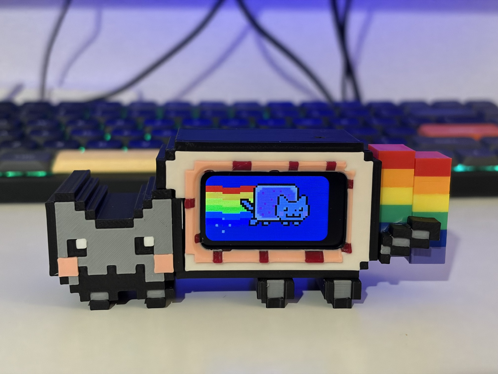
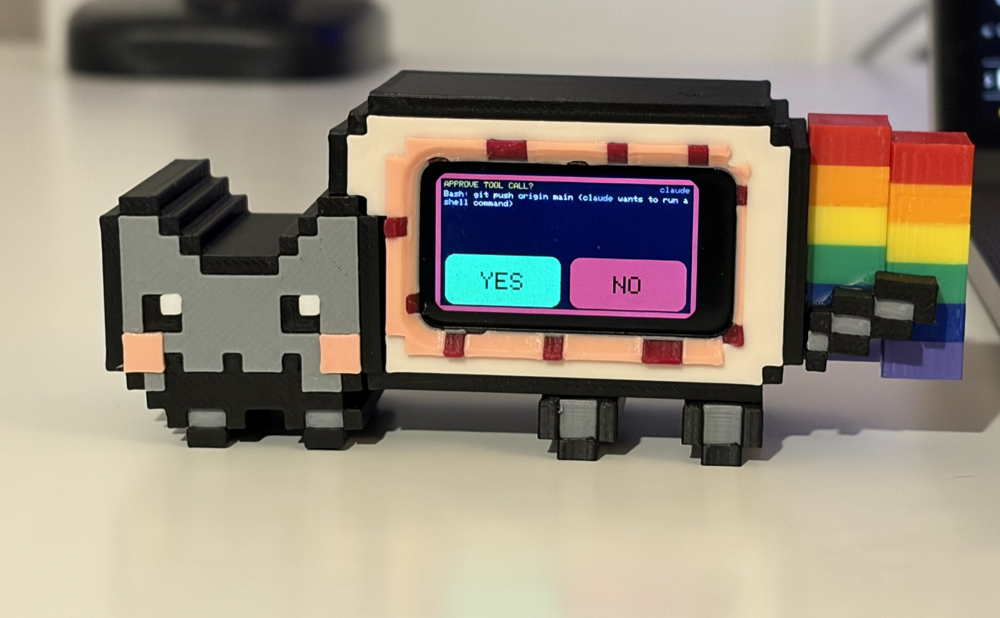
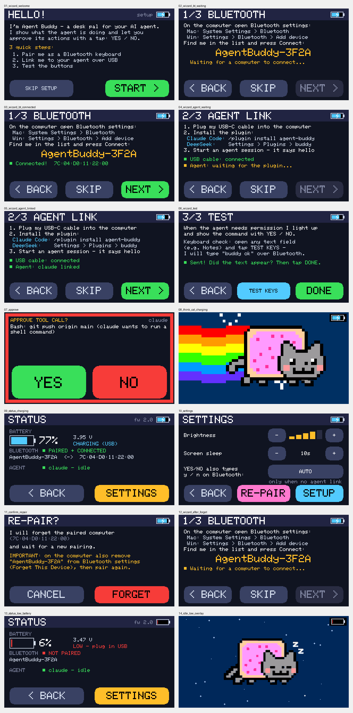
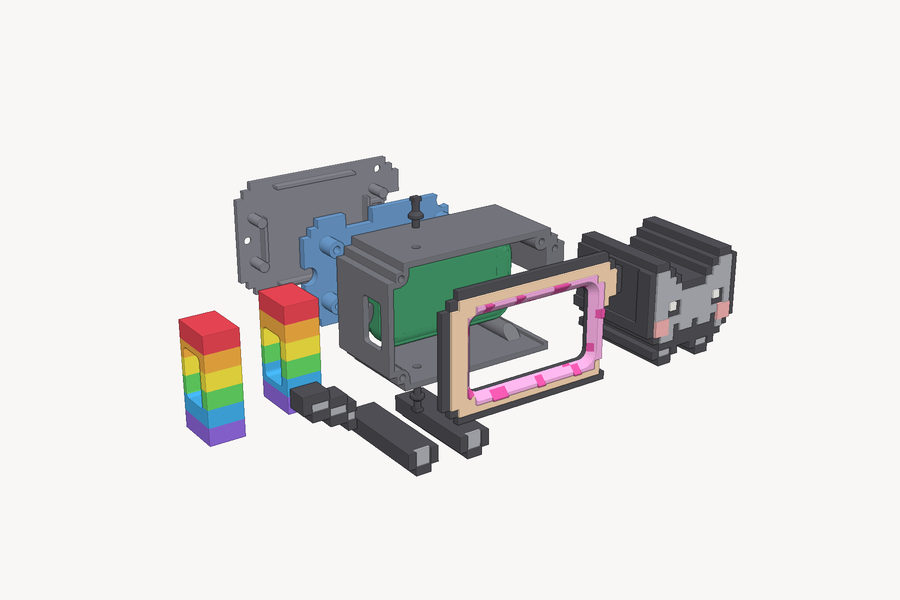
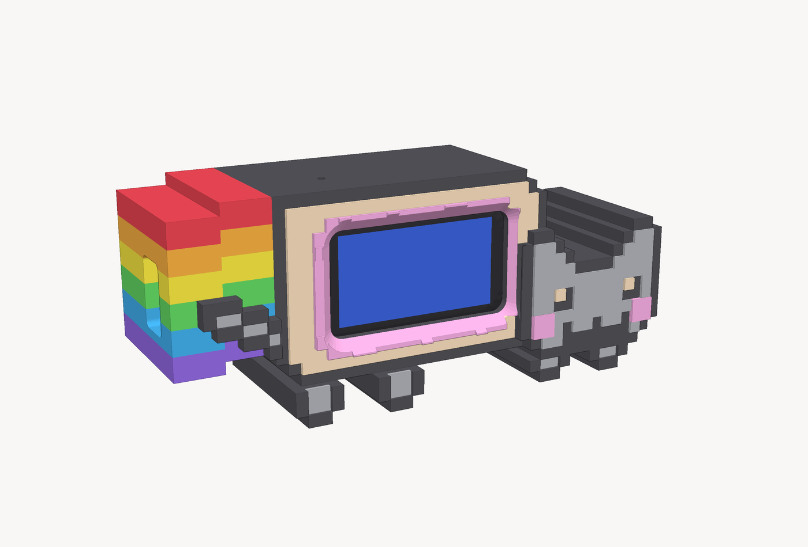
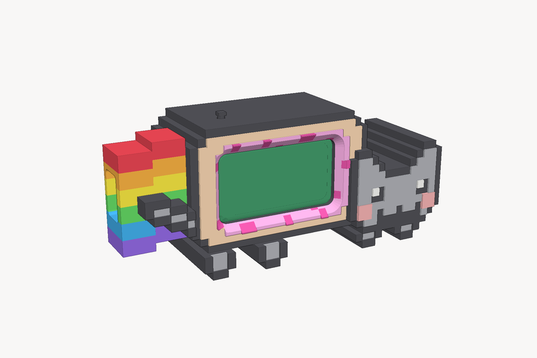
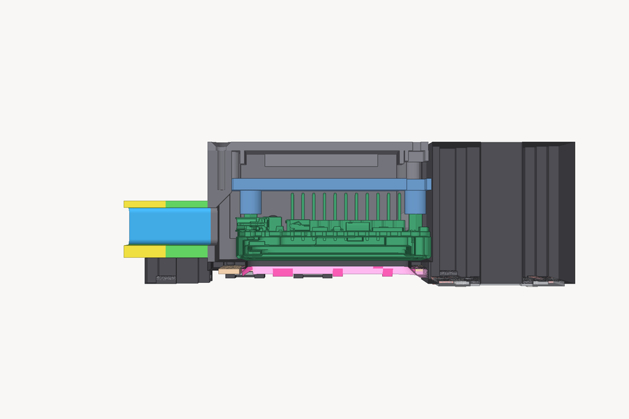
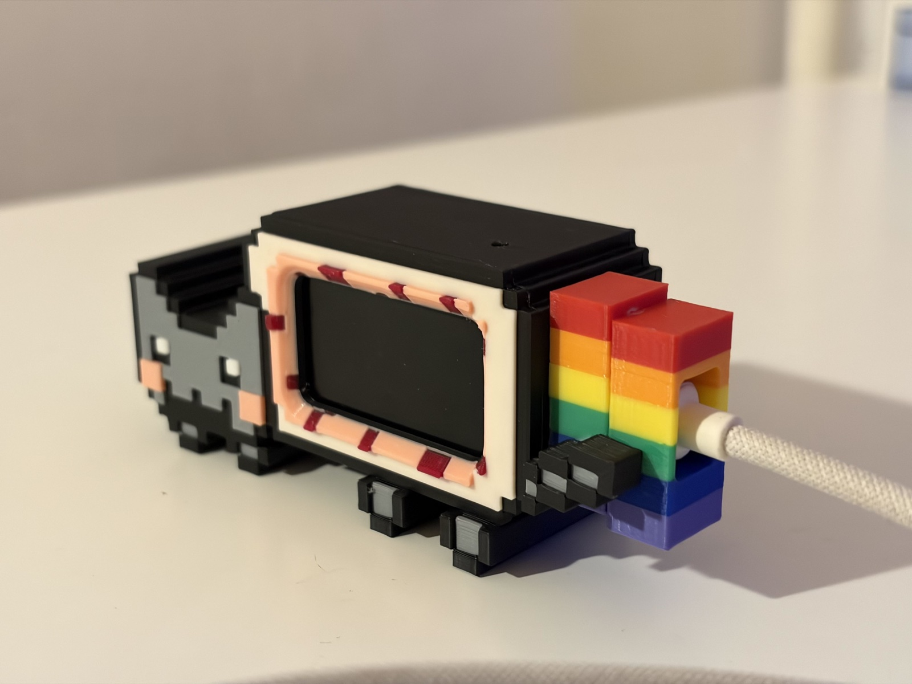

# nyan-buddy — настольный котик для ИИ-агента

**Agent Buddy** — маленький экран на столе, который показывает, чем занят ваш ИИ-агент
([Claude Code](https://claude.com/claude-code) или DeepSeek Harness), и даёт
**подтверждать его действия касанием**: агент хочет выполнить команду, на плате загорается
запрос с кнопками `YES` / `NO`, вы тапаете, и ответ уходит агенту. Связь с агентом идёт по USB
или по Bluetooth, а для системы плата заодно работает как Bluetooth-клавиатура.

Всё собрано на плате **Waveshare ESP32-S3-Touch-LCD-1.47** в напечатанном на 3D-принтере
корпусе в виде пиксельного Nyan Cat.



*На фото — собранный котик в корпусе **v1**: по нему и написан этот гайд. Корпус v2,
исправляющий проблемы v1, смоделирован, но ещё не напечатан (см. [9.5](#95-корпус-v2-следующая-версия)).*

---

## Оглавление

1. [Что умеет](#1-что-умеет)
2. [Как это устроено](#2-как-это-устроено)
3. [Что понадобится](#3-что-понадобится)
4. [Шаг 1. Подготовка платы и батареи](#4-шаг-1-подготовка-платы-и-батареи)
5. [Шаг 2. Сборка и прошивка](#5-шаг-2-сборка-и-прошивка)
6. [Шаг 3. Первое включение и Bluetooth](#6-шаг-3-первое-включение-и-bluetooth)
7. [Шаг 4. Плагин для Claude Code](#7-шаг-4-плагин-для-claude-code)
8. [Шаг 5. Плагин для DeepSeek Harness](#8-шаг-5-плагин-для-deepseek-harness)
9. [Шаг 6. Печать корпуса](#9-шаг-6-печать-корпуса)
10. [Шаг 7. Сборка корпуса](#10-шаг-7-сборка-корпуса)
11. [Как пользоваться](#11-как-пользоваться)
12. [Полная проверка: чек-лист](#12-полная-проверка-чек-лист)
13. [Если что-то не работает](#13-если-что-то-не-работает)
14. [Для разработчиков](#14-для-разработчиков)

Шаги 6–7 (корпус) можно делать в любой момент: плата полностью работает и без него.

> ⚠️ **Перед покупкой батареи прочитайте [про ток зарядки](#ток-зарядки-2-а-прочитайте-до-покупки-батареи)**:
> плата заряжает током до 2 А, а это много для маленького LiPo.

---

## 1. Что умеет

- **Живой статус агента.** У каждого состояния своя анимация:

  | Состояние | Что на экране |
  |---|---|
  | агент ждёт вас (`idle`) | спящий котик с буквами «z»; через несколько секунд экран гаснет |
  | агент думает (`think`) | Nyan Cat с радугой |
  | агент выполняет инструмент (`tool`) | Nyan Cat и строка с командой, например `Bash: git status` |
  | нужно подтверждение (`approve`) | текст команды, большие `YES` / `NO`, мигающая рамка |
  | подтвердили / отказали | «крутой» кот / кот «nope» |

- **Подтверждение касанием.** `YES` разрешает действие один раз, `NO` запрещает. Если плата
  не отвечает или никто не нажал за 45 секунд, вопрос уходит в обычное окно агента: работа
  никогда не блокируется.

  

- **Без провода.** Без кабеля статус и подтверждения идут по Bluetooth, а когда кабель
  воткнут, связь переходит на USB.
- **Bluetooth-клавиатура.** Плата сопрягается с компьютером как обычная клавиатура
  `AgentBuddy-XXXX`; кнопки `YES` / `NO` могут печатать `y` / `n` (режим настраивается).
- **Мастер настройки** при первом включении: сопряжение, связь с агентом, проверка клавиатуры.
- **Экраны статуса и настроек** на самой плате: батарея и зарядка, Bluetooth, агент,
  яркость, сон экрана, режим клавиш, перепривязка.
- **Батарея и экономия.** LiPo 600 мА·ч, индикатор заряда. Тёмный экран переводит дисплей
  в сон, а процессор — на 80 МГц. Режим **Standby** на батарее вдали от компьютера
  выключает радио и будится касанием.
- **Два агента.** Плагины для Claude Code и для DeepSeek Harness; одновременно платой
  управляет один, второй ждёт.



---

## 2. Как это устроено

```
 Mac                                                              плата ESP32-S3
 ┌──────────────────────────────────────────────────┐            ┌──────────────────┐
 │ Claude Code ─ хуки ─► buddy.py ──┐               │            │ экран 172×320    │
 │             ─ MCP ──► mcp_server ┤ HTTP :8789    │  USB-кабель│ тач YES / NO     │
 │                                  ▼               ├───────────►│ батарея          │
 │                             buddyd.py ───────────┤            │ BLE-клавиатура   │
 │                                  └── buddy-ble ──┤  Bluetooth │ BLE-канал агента │
 │ DeepSeek Harness ─ index.js ─ bridge.py ─────────┤───────────►│                  │
 └──────────────────────────────────────────────────┘            └──────────────────┘
```

- **Прошивка** (`Arduino/nyancat/`) рисует анимации, обрабатывает тач и говорит с компьютером
  простым текстовым протоколом: `S|think`, `S|approve|id|текст` → `E|approve|id|1`.
  Протокол одинаковый по USB и по Bluetooth.
- **Плагин Claude Code** (`plugins/claude-agent-buddy/`) ловит события Claude Code через
  хуки и передаёт их фоновой программе `buddyd.py`, которая держит связь с платой.
- **Плагин DeepSeek Harness** (`plugins/dsh-agent-buddy/`) делает то же для DeepSeek.
- **`buddy-ble`** — маленькая программа на Swift, через которую оба плагина говорят с платой
  по Bluetooth. Плагин собирает её сам при первом запуске.

---

## 3. Что понадобится

### Железо

| Что | Сколько | Комментарий |
|---|---|---|
| **Waveshare ESP32-S3-Touch-LCD-1.47** | 1 | с припаянными штыревыми разъёмами; латунные стойки M2×4 идут в комплекте |
| Кабель USB-C с передачей данных | 1 | зарядный «только питание» не подойдёт |
| Аккумулятор LiPo **602535** или **603035**, 3,7 В, 500–650 мА·ч, **с платой защиты** | 1 | по желанию: без него плата работает от USB. У нас 602535, 600 мА·ч |
| Провода Dupont **«мама-папа»** | 2 | подключение батареи к штырям VBAT/GND (или припаять провод 26–28 AWG) |
| Ползунковый выключатель **SS12D00G3** | 1 | **по желанию**, выключатель батареи; у нас его нет |
| Винт **M2×10** (или M2×8) | 4 | шасси → латунные стойки платы |
| Саморез **M2×8** с потайной головкой | 3 | крышка корпуса |
| Обрезки филамента 1,75 мм по 4 мм | 4 | штифты: лицевая панель ↔ корпус |
| Вспененный двусторонний скотч 0,5 мм, суперклей-гель или эпоксидка | — | окно экрана, батарея, радуга, голова, хвост |

### Инструменты

- паяльник — только если ставите тумблер (одна пайка), термоусадка или изолента;
- **мультиметр**: проверить полярность батареи;
- маленькая крестовая отвёртка;
- многоцветная 3D-печать: файлы 3MF подготовлены под **Bambu Lab + AMS**, PLA: чёрный +
  бежевый, розовый, серый, белый + 6 цветов радуги. Своего принтера нет — отдайте 3MF в
  сервис печати (см. 9.3).

### Софт

- **macOS** (Bluetooth-связь с агентом сделана через CoreBluetooth; прошивать можно и с Linux/Windows);
- [Homebrew](https://brew.sh), `arduino-cli`, Python 3 (есть в macOS), Xcode Command Line Tools
  (`xcode-select --install`: в них `swiftc` для Bluetooth-моста);
- Claude Code и/или DeepSeek Harness.

---

## 4. Шаг 1. Подготовка платы и батареи

> Без батареи этот шаг можно пропустить: плата работает от USB.

1. **Найдите VBAT и GND.** Переверните плату экраном вниз, USB-C вверх. Нужны **первые два
   штыря верхнего ряда возле USB-C в правом ряду**: VBAT и GND. Подписи есть на шелкографии
   платы, сверьтесь с ней.
2. **Проверьте полярность батареи мультиметром** (режим постоянного напряжения, 20 V):
   щуп «+» на красный провод, «−» на чёрный. Должно быть около **+3,7…4,2 В**. Если показывает
   минус, провода перепутаны: у дешёвых батарей так бывает, тогда «+» — это чёрный.
3. **Подключение.** Два варианта:
   - **напрямую** (так собран котик на фото): «+» батареи → разъём Dupont «мама» на **VBAT**,
     «−» → на **GND**. Паять ничего не нужно. В корпусе v1 за штырями мало места, разъёмы
     входят впритык; надёжнее припаять провода прямо у основания штырей;
   - **через выключатель**: «+» батареи → выключатель → VBAT, «−» → GND.
     Пайку закройте термоусадкой.
4. **«Разбудите» плату:** после подключения батареи один раз подайте питание по USB. Красный
   светодиод на плате означает зарядку, а не работу ESP32.

### Ток зарядки 2 А: прочитайте до покупки батареи

Зарядная микросхема платы **ETA6098** настроена резистором **R18 = 82 кОм** на ток **2 А**
(по [даташиту](http://www.eta-semi.com/wp-content/uploads/2022/03/ETA6098_V1.1.pdf):
82 кОм → 2 А). Для батареи 500–650 мА·ч это 3–4C, а LiPo обычно заряжают током не выше 1C:
батарея греется и со временем может вздуться. Мы сами заметили, что плата заметно греется
именно во время зарядки.

Что делать, от лучшего к худшему:

1. **Заменить R18 на ≈ 330 кОм** — ток станет ≈ 0,5 А (I ≈ 164 / R[кОм]). Это резистор
   размера 0201 рядом с U3 (ETA6098) и дросселем L3; в сервисе по ремонту телефонов замена
   займёт пару минут. Для батареи 400 мА·ч — ≈ 470 кОм (≈ 0,35 А).
2. **Заряжать только от USB-порта компьютера.** Порт отдаёт ~0,5 А, и входной ограничитель
   зарядника снижает ток. От зарядки телефона на 2–3 А ток снова будет 2 А.
3. Поставить батарею ≥ 2000 мА·ч: в корпус не влезет.

> **Без тумблера плата не выключается** и работает, пока не сядет батарея. Это не страшно:
> вдали от компьютера она сама уходит в Standby (около 1–3 мА, см. раздел 11), а когда
> кабель воткнут, батарея заряжается. Если плата не нужна долго (недели), отсоедините провод
> от VBAT: глубокий разряд вредит LiPo.

Напряжение батареи плата измеряет сама (GPIO12, делитель 1:3) и показывает на экране STATUS.

---

## 5. Шаг 2. Сборка и прошивка

### 5.1. Установка инструментов (один раз)

```bash
brew install arduino-cli
arduino-cli config init
arduino-cli config add board_manager.additional_urls \
  https://espressif.github.io/arduino-esp32/package_esp32_index.json
arduino-cli core update-index
arduino-cli core install esp32:esp32@2.0.14
```

> **Нужна именно версия ядра 2.0.14.** Код защищённого Bluetooth-соединения и драйверы
> написаны под её API; на 3.x сопряжение не будет настроено.

### 5.2. Библиотека дисплея (один раз)

Прошивке нужна **GFX Library for Arduino версии 1.5.9**, лежащая прямо в папке скетча
(в git она не входит, это 26 МБ). Более новая 1.6.x не подходит.

```bash
cd Arduino/nyancat
arduino-cli lib download "GFX Library for Arduino@1.5.9"
# команда напишет, куда сохранила zip (обычно ~/Library/Arduino15/staging/libraries/)
unzip ~/Library/Arduino15/staging/libraries/GFX_Library_for_Arduino-1.5.9.zip -d /tmp/gfx
mv /tmp/gfx/GFX_Library_for_Arduino* ./GFX_Library_for_Arduino
grep version GFX_Library_for_Arduino/library.properties   # должно быть version=1.5.9
```

### 5.3. Ориентация экрана

В `Arduino/nyancat/nyancat.ino` найдите строку с `gfx->setRotation(`:

| Как стоит плата | Значение |
|---|---|
| USB-C **справа**: корпус v1 как на фото (голова слева) или плата без корпуса. **Так в репозитории** | `setRotation(1)` |
| USB-C **слева**: корпус v2 (голова справа) | `setRotation(3)` |

Тач подстраивается под поворот сам.

### 5.4. Сборка

```bash
cd Arduino/nyancat
arduino-cli compile \
  --fqbn "esp32:esp32:esp32s3:CDCOnBoot=cdc,FlashSize=16M,PSRAM=opi,PartitionScheme=app3M_fat9M_16MB" \
  --library ./GFX_Library_for_Arduino \
  --build-path ./build .
```

В конце должно быть `Скетч использует ~1,43 МБ (45%)`. Схема разделов
`app3M_fat9M_16MB` обязательна: в стандартную (1,2 МБ под программу) прошивка не влезает.

### 5.5. Прошивка и самотест одной командой

Подключите плату кабелем и запустите (или дважды щёлкните файл в Finder):

```bash
./build_flash_test.command
```

Скрипт сам соберёт прошивку, найдёт порт `/dev/cu.usbmodem*`, на время прошивки отодвинет
плагины, которые держат порт, прошьёт плату и запустит самотест `tools/selftest.py`.
Полный лог пишется в `tools/build_flash.log`.

Самотест попросит: **«ON THE BOARD: tap the green YES button»**. Тапните зелёную `YES` на
экране платы. Ожидаемый конец вывода:

```
I|fw=2.0|name=AgentBuddy-XXXX|...|bat=4038|pct=87|pwr=charging|usb=1|...
APPROVE_OK (YES tapped)
SELFTEST_OK
```

- `I|fw=2.0`: новая прошивка работает и отвечает;
- `bat` 3300–4200: батарея подключена и измеряется;
- `APPROVE_OK`: **главная проверка** — экран подтверждения появляется, тач работает.

### 5.6. Если прошивка не заливается

- **«Порт занят» / «No serial data received»**: закройте монитор порта, Arduino IDE,
  DeepSeek Harness. Плагины скрипт отодвигает сам, а чужие программы — нет.
- **Автосброс не сработал**: переведите плату в режим загрузки вручную: **зажмите BOOT →
  коротко нажмите RESET → отпустите BOOT**. В корпусе v1 кнопки через корпус не нажать
  (см. 9.4): снимите крышку. В v2 — скрепкой через отверстия сверху и снизу. Затем запустите
  прошивку снова. Обычно автосброс срабатывает сам, и кнопки не нужны.
- **После прошивки чёрный экран**: выньте и вставьте USB (полный цикл питания).
- **Откат на старую прошивку v1**: её исходники в коммите `8214eee`
  (`git worktree add /tmp/nyan-v1 8214eee`, собрать оттуда так же).

Подробности для разработчиков: [`Arduino/nyancat/AGENTS.md`](Arduino/nyancat/AGENTS.md).

---

## 6. Шаг 3. Первое включение и Bluetooth

После первой прошивки плата открывает **мастер настройки** из трёх шагов (экраны — на
картинке в разделе 1).

### HELLO
Тапните **START** (или **SKIP SETUP**, если хотите всё настроить позже).

### 1/3 BLUETOOTH: сопряжение с Mac

На экране крупно написано имя платы, например **`AgentBuddy-3890`**; последние цифры у
каждой платы свои.

1. На Mac откройте **Системные настройки → Bluetooth**.
2. **Поднесите плату к Mac вплотную (10–20 см).** macOS показывает новые Bluetooth-клавиатуры
   в списке только при сильном сигнале (выше −60 dBm); на расстоянии вытянутой руки плата
   может не появиться.
3. Внизу, в разделе **«Устройства поблизости»**, появится `AgentBuddy-XXXX`.
4. **Наведите курсор на строку**: справа появится кнопка **«Подключить»**. На macOS 15
   она видна только при наведении.
5. Код вводить не нужно. На плате появится зелёное **`Connected!`** и адрес Mac.
   Тапните **NEXT**.

После сопряжения плата переезжает в **«Мои устройства»**, и macOS показывает там же её заряд
батареи: прошивка отдаёт его как стандартная Bluetooth-клавиатура.


После этого Mac сам подключается к плате при каждом её включении.

> Кнопки «Подключить» нет, хотя плата в списке? **Закройте и снова откройте Системные
> настройки.** Помогало именно это.

### 2/3 AGENT LINK: связь с агентом

Шаг ждёт, пока с платой заговорит плагин агента: строка `Agent: waiting for the plugin...`.
Установите плагин (шаг 4 или 5 ниже), он подключится сам, и строка станет зелёной:
`Agent: claude linked`. Можно нажать **SKIP** и вернуться позже: котик → SETTINGS → SETUP.

### 3/3 TEST: проверка клавиатуры

Откройте на Mac любое текстовое поле (Заметки, TextEdit), поставьте туда курсор и тапните
**TEST KEYS**: плата напечатает `buddy ok` по Bluetooth. Затем **DONE**.

---

## 7. Шаг 4. Плагин для Claude Code

### 7.1. Установка

В Claude Code (в строке ввода, как обычное сообщение):

```
/plugin marketplace add ~/Documents/deepseek-harness/default-workspace/plugins
/plugin install agent-buddy@nyan-buddy
/reload-plugins
```

Путь в первой команде — папка `plugins` вашей копии репозитория. Если Claude Code не
предложит `/reload-plugins`, перезапустите его (`claude --continue` продолжит ту же беседу).

Отдельно ставить ничего не нужно: Python берётся системный, `pyserial` не требуется.

### 7.2. Разрешение на Bluetooth

Когда плата первый раз работает без кабеля, плагин собирает и запускает `buddy-ble`, и macOS
спрашивает: **«"Python" хочет использовать Bluetooth»** (или «buddy-ble»). Нажмите
**«Разрешить»**. Если окна не было, а связи нет: **Системные настройки → Конфиденциальность и
безопасность → Bluetooth**, включите Python / buddy-ble.

### 7.3. Проверка

```
/agent-buddy:status
```

Ожидаемый ответ:

```
Device: online on /dev/cu.usbmodem1101 (fw 2.0, AgentBuddy-3890)   ← или "online on bluetooth"
Battery: 87% (4.04 V), power: charging
Bluetooth keyboard: paired and connected with B0:BE:83:60:72:40
Setup wizard: done
Settings: brightness 2/4, screen sleep 10s, y/n keys auto
Approvals: device (timeout 45s)
```

Дальше живая проверка:

1. Попросите Claude что-нибудь сделать: на плате, пока он думает, бежит **радуга**, а пока
   выполняет команду — её текст.
2. Попросите действие, которое требует разрешения (например, создать файл в новой папке):
   на плате загорится **APPROVE** с текстом команды. Тапните `YES`: Claude продолжит,
   диалог в терминале не появится.
3. Выдерните кабель: через 2–3 секунды связь перейдёт на Bluetooth, анимации продолжатся.

### 7.4. Команды и настройки

| Команда | Что делает |
|---|---|
| `/agent-buddy:status` | связь, батарея, Bluetooth, настройки |
| `/agent-buddy:pair` | пошаговое сопряжение (открывает мастер на плате) |
| `/agent-buddy:pair repair` | забыть сопряжение и привязать заново |
| `/agent-buddy:settings brightness 3` | яркость 0–4 |
| `/agent-buddy:settings sleep 30` | гасить экран через 5/10/30/60 с, 0 — никогда |
| `/agent-buddy:settings keys auto` | печатать `y`/`n`: `off`, `auto` (только без связи с агентом), `always` |
| `/agent-buddy:settings approvals terminal` | только показывать запросы, отвечать в терминале |
| `/agent-buddy:settings approve_timeout 60` | через сколько секунд вопрос уходит в терминал |

> **Режим клавиш `auto` — рекомендуемый.** В режиме `always` нажатие `YES` не только
> отвечает агенту, но и печатает `y` в активное окно (например, в тот же терминал).

Отладка без Claude:

```bash
python3 plugins/claude-agent-buddy/scripts/buddy.py status
python3 plugins/claude-agent-buddy/scripts/buddy.py show "Привет"      # текст на плату
python3 plugins/claude-agent-buddy/scripts/buddy.py set ble off       # только USB
python3 plugins/claude-agent-buddy/scripts/buddy.py stop              # остановить фоновую программу
```

Лог: `~/.config/agent-buddy/daemon.log`, конфиг: `~/.config/agent-buddy/config.json`.

Статус-строка Claude Code (по желанию), в `~/.claude/settings.json`:

```json
{ "statusLine": { "type": "command",
  "command": "python3 ~/Documents/deepseek-harness/default-workspace/plugins/claude-agent-buddy/scripts/buddy.py statusline" } }
```

### 7.5. Обновление плагина

После `git pull` обновите копию в кэше Claude Code:

```
/plugin marketplace update nyan-buddy
```

Если версия не обновилась: `/plugin uninstall agent-buddy@nyan-buddy`, затем снова
`/plugin install agent-buddy@nyan-buddy`.

---

## 8. Шаг 5. Плагин для DeepSeek Harness

### 8.1. Установка

```bash
python3 -m pip install pyserial          # нужен для USB
dsh plugin --profile desktop add "$PWD/plugins/dsh-agent-buddy"
```

В окне DeepSeek Harness откройте **Плагины** на боковой панели, найдите в «Установленных
плагинах» **Agent Buddy (ESP32 display)** и включите переключатель. Если плагина там нет,
проверьте, что команда `dsh plugin add` выше прошла без ошибок, и нажмите **«Обновить»**.


> После любых правок плагина его нужно **выключить и включить** (или перезапустить
> DeepSeek Harness): горячая перезагрузка изменения не подхватывает.

### 8.2. Проверка

```bash
curl http://127.0.0.1:8788/status
# {"state":"idle","connected":true,"via":"usb","build":"v5","timeout":20000}
```

- `connected: true` — плата отвечает (проверяется пингом каждые 2,5 с);
- `via` — `usb` или `bluetooth`;
- `build: "v5"` — актуальная версия плагина.

Затем дайте DeepSeek задачу: на плате должна побежать радуга, а запросы на подтверждение
должны появляться с кнопками `YES` / `NO`.

### 8.3. Настройки (`plugins/dsh-agent-buddy/cordis.patch.yml`)

| Параметр | По умолчанию | Значение |
|---|---|---|
| `port` | `/dev/cu.usbmodem1101` | предпочитаемый порт; если его нет, берётся любой `usbmodem`, затем Bluetooth |
| `python` | `python3` | интерпретатор с `pyserial` |
| `approvals` | `on` | `on` — отвечает плата; `off` — только показывать |
| `timeoutMs` | `20000` | служебный таймаут |

### 8.4. Claude Code и DeepSeek одновременно

Платой в каждый момент управляет **один** агент — тот, кто подключился первым (общий файл
блокировки `/tmp/nyan-buddy-bridge.lock`, и для USB, и для Bluetooth). Второй ждёт и
подхватывает плату, когда первый её отпустит. Фоновая программа Claude Code держит плату
до 3 часов после последнего действия. Чтобы отдать плату DeepSeek сразу:

```bash
python3 plugins/claude-agent-buddy/scripts/buddy.py stop
```

---

## 9. Шаг 6. Печать корпуса



Корпус **v1** — пять столов печати. Все файлы в `Arduino/nyancat/art/cad/print/`; там же
STL по цветам (`*_stl/`), а вся сборка в STEP лежит в `../out/pixel_nyan_assembly.step`.
Габарит котика ≈ 103 × 45 × 34 мм.

### 9.1. Файлы

| Файл | Детали | Цвета (номер = филамент в 3MF) |
|---|---|---|
| `01_faceplate.3mf` | лицевая панель поп-тарта | 1 чёрный, 2 бежевый, 3 розовый, 4 малиновый |
| `02_head.3mf` | голова с передними лапками | 1 чёрный, 2 серый, 3 белый, 4 розовый (щёки) |
| `03_tail_backlegs.3mf` | хвост и задние лапки | 1 чёрный, 2 серый |
| `04_rainbow.3mf` | радуга, половинки A и B | фиолетовый → синий → зелёный → жёлтый → оранжевый → красный |
| `05_black_parts.3mf` | корпус, шасси, крышка, толкатели кнопок (по 2 запасных) | чёрный |

Пластика ≈ 70 г, почти всё чёрный, плюс отходы на смену цвета.

### 9.2. Настройки печати

- PLA, сопло 0,4 мм, слой **0,2 мм**, **3 периметра**, заполнение **15 %** (гироид).
- **Поддержки не нужны**: нависания проверены, остались только короткие мосты до 8,6 мм.
- Ориентация уже задана в файлах:

  | Стол | Как стоит | Примечание |
  |---|---|---|
  | 01 лицевая панель | лицом вверх | цвет только в верхних ~2,6 мм; можно включить ironing |
  | 02 голова | лицом вверх | цвет только в верхних 1,8 мм |
  | 03 хвост + лапки | хвост лицом вверх, лапки вверх ногами | |
  | 04 радуга | стоя | кайма (brim) желательна |
  | 05 чёрные детали | корпус передним краем вниз, шасси и крышка внешней стороной вниз | толкатели крошечные: с каймой, лучше слоем 0,12 |

### 9.3. Bambu Studio + AMS

> **Нет своего принтера?** Отправьте в сервис 3D-печати пять файлов `*.3mf` из
> `art/cad/print/` вместе с таблицами 9.1–9.2: цвета, слой 0,2 мм, заполнение 15 %, без
> поддержек. Многие сервисы печатают на Bambu Lab с AMS и примут 3MF как есть.

1. **Файл → Открыть проект** → `01_faceplate.3mf`. Цвета уже назначены по частям объекта.
   Если слайсер не разнёс их по филаментам сам, назначьте вручную: части называются
   `black`, `pink`, `beige` и т. д.
2. Вставьте катушки в AMS и сопоставьте слоты с филаментами 1–4 из таблицы выше.
3. **Нарезать** → **Отправить на печать**. Так же печатаются `02_head`, `03_tail_backlegs`
   и `05_black_parts`.
4. **Радуга: 6 цветов, а у AMS 4 слота.** Каждый цвет — отдельная полоса по высоте, поэтому:
   - **два AMS или AMS + внешняя катушка**: открыть `04_rainbow.3mf` как есть;
   - **или смена филамента по высоте**: в превью нарезки поставьте паузу / смену филамента
     на **4,8 / 9,6 / 14,4 / 19,2 / 24,0 мм** (снизу вверх: фиолетовый → синий → зелёный →
     жёлтый → оранжевый → красный) и меняйте катушку во время паузы. Так можно печатать и на
     одноцветном принтере (M600).

### 9.4. Известные проблемы v1

Мы напечатали и собрали v1. Вот что не получилось как задумано:

| Проблема | Что видно | Как обойти в v1 | В v2 |
|---|---|---|---|
| **Экран не по центру окна** | окно смещено на ~2,5 мм к USB-C (ошибка в модели) | смириться: видно, но не мешает | исправлено; модуль сам центруется по фаске |
| **Толкатели BOOT/RESET не встали** | кнопки не нажать через корпус | для прошивки снять крышку; обычно автосброс работает и так | толкатели убраны, отверстия Ø1,5 под скрепку |
| **Мало места под провода батареи** | разъёмы Dupont на VBAT/GND входят впритык | паять провода у основания штырей или аккуратно поджать | окно 16,5 × 13 мм в шасси, батарея ниже |
| **Радуга и голова сели неровно** | радуга не совпадает с корпусом по высоте, голова отходит | подклеить, подшлифовать | радуга вровень с корпусом; голова и лицо — одна деталь с корпусом |

### 9.5. Корпус v2: следующая версия



v2 исправляет все проблемы из 9.4. Он **смоделирован и проверен на модели** (зазоры, провода,
выключатель, штекер USB-C), но **ещё не напечатан**. Отличия от v1:

- голова **справа**, USB-C **слева** через радугу → в прошивке `setRotation(3)`;
- корпус, лицо, голова и лапки — **одна деталь**, клеятся только радуга и хвост;
- гнездо под выключатель SS12D00G5 на крышке;
- три стола вместо пяти: `art/cad/v2/print/01_body_tail.3mf`, `02_rainbow.3mf`, `03_chassis_cover.3mf`.

Полная инструкция v2 — [`Arduino/nyancat/art/cad/v2/СБОРКА_v2.md`](Arduino/nyancat/art/cad/v2/СБОРКА_v2.md),
инфографика — [`assembly_v2.png`](Arduino/nyancat/art/cad/v2/views/assembly_v2.png).

---

## 10. Шаг 7. Сборка корпуса



> **Ориентация.** Модель v1 рисовалась с головой справа, но мы собрали котика **зеркально**:
> голова слева, радуга и USB-C справа (как на фото). Детали это позволяют, а прошивка в
> репозитории (`setRotation(1)`) настроена именно так. Ниже — порядок для нашего варианта.

**1. Лицевая панель.** Вставьте 4 штифта из филамента (обрезки 1,75 мм по 4 мм) в отверстия
переднего торца корпуса, наденьте панель и приклейте. По краю окна изнутри наклейте
вспененный скотч 0,5 мм: на него ляжет стекло экрана.

**2. Батарея к плате.** Наденьте разъёмы Dupont на **VBAT** и **GND** (первые два штыря
правого ряда у USB-C, вид на плату сзади) или припаяйте провода у основания штырей.
См. [шаг 1](#4-шаг-1-подготовка-платы-и-батареи). Места за штырями мало: следите, чтобы
провода не мешали шасси.

**3. Шасси.** Прикрутите шасси к четырём латунным стойкам платы винтами M2×10, головки
утапливаются заподлицо. Винт должен войти в стойку на ~3,5 мм; если упирается, возьмите M2×8.
Провода к батарее выведите через вырез в верхнем крае шасси.

**4. Модуль в корпус.** Сзади вдвиньте модуль с шасси экраном вперёд, **USB-C вправо**, до
упора стеклом в лицевую панель.

**5. Батарея в крышку.** Положите батарею в карман на крышке на двусторонний скотч.

**6. Крышка.** Закройте тремя саморезами M2×8. Стойки на крышке поджимают шасси, и модуль
зажат между ними и лицевой панелью.

**7. Голова.** Приклейте голову к **левому** боку корпуса.

**8. Радуга, хвост, лапки.** Склейте половинки радуги по туннелю (туннели должны совпасть)
и приклейте радугу к **правому** боку, туннелем к USB-C. Хвост приклейте на радугу, задние
лапки — под поп-тарт.

**USB-C** подключается через туннель в радуге (13,6 × 8,6 мм, глубина до разъёма ≈ 25 мм).
Подходит штекер с корпусом до 13 × 8 мм и длиной от 20 мм, то есть большинство обычных
кабелей. Толстые кабели в металлической оплётке могут не пройти.





---

## 11. Как пользоваться

### Касания

| Где | Что делает тап |
|---|---|
| по котику | открывает **STATUS** |
| STATUS → **SETTINGS** | настройки |
| по погасшему экрану | только будит его (ничего не нажимает) |
| `YES` / `NO` на запросе | ответ агенту |

STATUS и SETTINGS закрываются сами через 30 секунд. Запрос на подтверждение всегда
перекрывает любые экраны.

### STATUS

Заряд и напряжение батареи, зарядка (`CHARGING (USB)` / `FULL`), сопряжение по Bluetooth и
адрес компьютера, связь с агентом (`claude - idle`).

### SETTINGS

- **Brightness:** яркость, 5 ступеней.
- **Screen sleep:** через сколько секунд гаснет экран со спящим котиком (5/10/30/60/никогда).
- **YES/NO also types y/n:** `OFF` / `AUTO` / `ALWAYS` (см. [7.4](#74-команды-и-настройки)).
- **RE-PAIR:** забыть компьютер и привязать заново. Перед этим удалите
  `AgentBuddy-XXXX` в настройках Bluetooth на Mac («Забыть это устройство»).
- **SETUP:** снова пройти мастер.

### Питание и батарея

| Режим | Примерный ток | Время от 600 мА·ч |
|---|---|---|
| экран горит, анимация | ~55–75 мА | ~7–9 ч |
| экран погашен, связь с агентом по Bluetooth | ~35–45 мА | ~11–15 ч |
| **Standby** (вдали от Mac) | ~1–3 мА | ~1–2 недели |

Цифры — оценка по типичным токам, а не замер. Реальную кривую разряда плата пишет сама,
см. [раздел 14](#14-для-разработчиков).

- **Standby** включается, когда плата **на батарее**, **связи с агентом нет** (компьютер
  далеко или плагин не запущен), а экран погашен 5 минут. Bluetooth выключается.
  Разбудить: **тап по экрану** (лучше придержать палец около секунды) или подключить кабель
  (до минуты). Плата перезапускается без заставки, Mac переподключается сам за пару секунд.
- Пока плагин на связи по Bluetooth, Standby не включается: плата нужна агенту.
- Плата слегка тёплая, особенно когда заряжается: тепло даёт в основном микросхема
  зарядки. Чип сообщает свою температуру (`tmp=` в ответе на пинг), обычно 45–50 °C.

---

## 12. Полная проверка: чек-лист

| # | Что проверить | Как | Ожидаемо |
|---|---|---|---|
| 1 | прошивка | `./build_flash_test.command` | `SELFTEST_OK` |
| 2 | экран подтверждения | самотест просит тапнуть YES | `APPROVE_OK (YES tapped)` |
| 3 | батарея | там же, строка `I\|…` | `bat` 3300–4200, `pwr` battery/charging/full |
| 4 | Bluetooth-клавиатура | мастер → 1/3 | `Connected!` |
| 5 | сопряжение запомнилось | перезагрузить плату: `python3 plugins/claude-agent-buddy/scripts/buddy.py reboot` | Mac подключается сам, в STATUS `PAIRED + CONNECTED` |
| 6 | клавиатура печатает | мастер → 3/3 → TEST KEYS | в текстовом поле `buddy ok` |
| 7 | плагин Claude по USB | `/agent-buddy:status` | `online on /dev/cu.usbmodem…` |
| 8 | анимации | дать Claude задачу | радуга при `think`, текст команды при `tool` |
| 9 | подтверждение | действие с запросом разрешения | APPROVE на плате, `YES` → Claude продолжает |
| 10 | без провода | выдернуть кабель | `/agent-buddy:status` → `online on bluetooth`, анимации идут |
| 11 | возврат на USB | воткнуть кабель | через 2–3 с снова `online on /dev/cu.usbmodem…` |
| 12 | плагин DeepSeek | `curl 127.0.0.1:8788/status` | `connected: true`, `build: "v5"` |
| 13 | Standby | кабель вынут, плагины остановлены, ждать 5 мин | экран тёмный; тап → котик без заставки |

---

## 13. Если что-то не работает

### Bluetooth

| Симптом | Причина и что делать |
|---|---|
| Плата не появляется в списке Bluetooth на Mac | Слабый сигнал: поднесите плату вплотную к Mac (macOS показывает только устройства сильнее −60 dBm) |
| Плата в списке, но нет кнопки «Подключить» | Наведите курсор на строку; не помогло — закройте и откройте Системные настройки |
| `bond=0`, сопряжение не сохраняется | На Mac «Забыть это устройство», на плате SETTINGS → RE-PAIR, подключить заново |
| Плата перезагружается при TEST KEYS | Старая прошивка (до коммита `351c72a`): обновите прошивку |
| Связь по Bluetooth не поднимается после обновления прошивки | На Mac «Забыть это устройство» и подключить заново: macOS кэширует список сервисов платы |

### Связь с агентом

| Симптом | Причина и что делать |
|---|---|
| Мастер висит на `Agent: waiting for the plugin...` | Плагин не установлен или не запущен, см. шаги 4–5. Для Claude: `/agent-buddy:status` |
| `Device: OFFLINE - USB port is owned by another program` | Плату держит DeepSeek (или идёт прошивка): закройте его или дождитесь |
| DeepSeek: `connected: false`, а плата работает | Плату держит Claude Code: `python3 plugins/claude-agent-buddy/scripts/buddy.py stop` |
| `Device: OFFLINE - board answers but runs old firmware` | Прошейте актуальную прошивку (нужен ответ на `S\|ping`) |
| По Bluetooth нет связи, в логе нет строк `ble:` | macOS ждёт разрешения: Конфиденциальность и безопасность → Bluetooth |
| `/agent-buddy:status` пишет, что инструмента нет | Старая версия плагина без MCP-сервера: обновите (7.5) |
| Подтверждение не появляется на плате, а сразу в терминале | Плата не на связи (проверьте статус) или включено `approvals terminal` |
| Нет радуги, когда плата на батарее | Плагин не запущен или Bluetooth выключен в его настройках (`buddy.py set ble auto`) |

### Плата

| Симптом | Причина и что делать |
|---|---|
| Котик застыл, на команды не отвечает | `buddy.py reboot`; если плата не отвечает — аппаратный сброс по USB: `esptool --chip esp32s3 --port /dev/cu.usbmodem* read_mac` (esptool из `~/Library/Arduino15/packages/esp32/tools/esptool_py/`). В v2 — RESET скрепкой |
| Картинка вверх ногами | Поменяйте `setRotation(1)` ↔ `setRotation(3)` (5.3) и перепрошейте |
| Порт поменял имя (`usbmodem101` вместо `usbmodem1101`) | Ничего делать не нужно: плагины и скрипт прошивки находят порт сами |
| Чёрный экран после прошивки | Полный цикл питания: выньте и вставьте USB |
| Батарея показывает `charging`, хотя заряжена | Зарядка определяется по напряжению: `full` начинается от 4,15 В |
| От блока питания без данных плата пишет `battery` | Так и задумано: «USB» плата видит только когда с компьютера идут данные |

Логи: плагин Claude — `~/.config/agent-buddy/daemon.log`; прошивка и самотест —
`Arduino/nyancat/tools/build_flash.log`.

---

## 14. Для разработчиков

### Протокол

Текстовые строки, одинаково по USB (115200 бод) и по Bluetooth-сервису
`6E400001-B5A3-F393-E0A9-E50E24DCCA9E` (RX `…0002` — запись, TX `…0003` — уведомления).

```
Компьютер → плата:
  S|idle  S|think  S|tool|<текст>  S|error|<текст>  S|approve|<id>|<текст>  S|cancel|<id>
  S|ping  S|info  S|host|<имя агента>
  S|cfg|bri|0..4  S|cfg|sleep|<сек>  S|cfg|kb|off|auto|always  S|cfg|setup|0
  S|unpair  S|wizard  S|reboot  S|log  S|logclr  S|standby|<задержка, с>
Плата → компьютер:
  E|hello                     после загрузки
  E|approve|<id>|1|0          тап YES / NO
  A|<состояние>               подтверждение смены состояния
  T|<x>|<y>                   тап
  I|fw=2.0|name=..|ble=..|bond=..|bat=..|pct=..|pwr=..|usb=..|bri=..|sleep=..|kb=..|tmp=..|mhz=..|log=..
  L|...                       журнал разряда батареи (ответ на S|log)
```

### Полезное

- **Хост-симуляция без платы:** `Arduino/nyancat/tools/hostsim/run.sh` компилирует скетч с
  заглушками, прогоняет сценарий с проверками и сохраняет кадры экранов.
- **Журнал разряда:** плата раз в 5 минут пишет напряжение в RTC-память (переживает
  перезагрузку, но не полное отключение питания). Прочитать: `S|log`, очистить: `S|logclr`.
- **Дамп сбоя:** ядро пишет coredump во флеш (раздел `coredump`, 0xFF0000); как его прочитать
  и расшифровать — в [`Arduino/nyancat/AGENTS.md`](Arduino/nyancat/AGENTS.md).
- **Модель корпуса:** `Arduino/nyancat/art/cad/nyan_cad_v2.py` (генерация), `check_v2.py`
  (проверка зазоров), `export_print_v2.py` (3MF/STL), `infographic_v2.py` (картинки).

### Структура репозитория

```
Arduino/nyancat/                 прошивка
  nyancat.ino                    состояния, экран, протокол, питание, Standby
  buddy_ui.*                     экраны мастера / статуса / настроек
  battery.*                      батарея, зарядка, журнал разряда
  ble_kb.*                       Bluetooth: клавиатура + канал связи с агентом
  esp_lcd_touch_axs5106l.*       тач
  nyan_anims.h, nyancat_frames.h анимации
  build_flash_test.command       сборка + прошивка + самотест
  tools/selftest.py, tools/hostsim/
  art/cad/v2/                    корпус Pixel Nyan v2 (STEP, 3MF, STL, картинки)
  AGENTS.md                      рабочие заметки и ловушки
plugins/
  .claude-plugin/marketplace.json   маркетплейс nyan-buddy для Claude Code
  claude-agent-buddy/               плагин Claude Code (хуки, MCP, демон, buddy-ble)
  dsh-agent-buddy/                  плагин DeepSeek Harness
```

### Известные ограничения

- Bluetooth-связь с агентом сделана только для **macOS**; на Linux/Windows — только USB.
- Лёгкий сон ESP32-S3 на ядре 2.0.14 не возвращается при подключённом USB-хосте, поэтому
  Standby работает только на батарее.
- Пока Mac рядом и плагин на связи, плата не уходит в Standby: от батареи — часы, а не дни.
- Время работы от батареи пока оценка; замер по журналу разряда ещё не делался.
