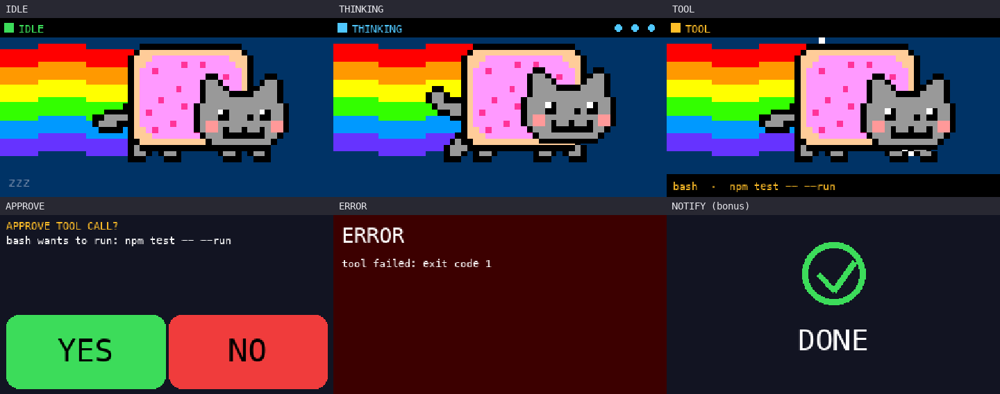

# nyan-buddy

A physical desk-side **Agent Buddy** for [DeepSeek Harness](https://github.com/deepseek-ai):
a Waveshare **ESP32-S3-Touch-LCD-1.47** shows the agent's live state, lets you
approve or reject tool calls with a touch button, and acts as a BLE / USB HID
keyboard.



## Features

- **Live status on the 172×320 screen** — a per-state pixel animation:
  the sleeping cat (idle), the classic Nyan Cat (thinking), the cool cat
  (approve) and the "nope" cat (reject).
- **Physical approve / deny** — a pending tool approval appears on the device
  with big `YES` / `NO` buttons and a red/green blinking frame; a tap sends
  `allowed-once` or `rejected` back to the Harness. If nobody taps within 6 s
  the request falls back to the normal GUI dialog.
- **`buddy_show` tool** — the agent can draw a short message on the device.
- **BLE HID keyboard** (`AgentBuddy`) — the board pairs as a wireless keyboard;
  approving sends `y`, denying sends `n`.
- **USB HID keyboard build** — optional wired variant (TinyUSB).
- **Flicker-free rendering** — each frame is composed in a PSRAM framebuffer and
  blitted with a single SPI flush.
- **Dim backlight + idle sleep** — the panel runs at ~45% brightness; after 10 s
  in idle the backlight turns off and wakes on any state change or a tap.

## Repository layout

```
Arduino/nyancat/            firmware
  nyancat.ino               display, states, touch, protocol
  nyan_anims.h              RLE-packed per-state animations (idle/think/approve/reject)
  nyancat_frames.h          RLE-packed 12-frame Nyan Cat animation
  esp_lcd_touch_axs5106l.*  AXS5106L touch driver (I2C)
  ble_kb.*                  BLE HID keyboard backend
plugins/dsh-agent-buddy/    DeepSeek Harness plugin bundle
  index.js                  Host: bridge, approval answerer, buddy_show
  bridge.py                 USB-CDC bridge (JSON lines ⇄ board protocol)
  client.js                 Client: status pill in the composer dock
  cordis.patch.yml          bundle patch + config
refwork/sketches/           state design sketches
refwork/NyanCat.gif         source Nyan Cat animation (thinking frames)
```

## Firmware

Target: `esp32:esp32:esp32s3` with `USBMode=hwcdc, CDCOnBoot=cdc, FlashSize=16M, PSRAM=opi`.

```bash
arduino-cli compile \
  --fqbn "esp32:esp32:esp32s3:UploadSpeed=921600,USBMode=hwcdc,CDCOnBoot=cdc,FlashSize=16M,PSRAM=opi" \
  --build-path .arduino15/build Arduino/nyancat

arduino-cli upload -p /dev/cu.usbmodem1101 \
  --fqbn "esp32:esp32:esp32s3:UploadSpeed=921600,USBMode=hwcdc,CDCOnBoot=cdc,FlashSize=16M,PSRAM=opi" \
  --input-dir .arduino15/build
```

For the **USB HID keyboard** variant (TinyUSB; replaces the USB-Serial/JTAG CDC,
so flashing then needs the BOOT button):

```bash
arduino-cli compile \
  --fqbn "esp32:esp32:esp32s3:UploadSpeed=921600,USBMode=default,CDCOnBoot=cdc,FlashSize=16M,PSRAM=opi" \
  --build-path .arduino15/build-usb \
  --build-property "compiler.cpp.extra_flags=-DUSB_HID_KB" Arduino/nyancat
```

## Plugin

```bash
dsh plugin --profile desktop add "$PWD/plugins/dsh-agent-buddy"
```

Requires `python3` with `pyserial` (the plugin auto-detects a working interpreter,
including the repo-local `.venv-esp`). The plugin exposes
`http://127.0.0.1:8788/status` → `{"state":"idle","connected":true}`.

Config (`cordis.patch.yml`):

| Field | Default | Meaning |
|---|---|---|
| `port` | `/dev/cu.usbmodem1101` | board USB CDC |
| `python` | `python3` | interpreter that has `pyserial` |
| `approvals` | `on` | `on` answers on the device; `off` mirrors and delegates |
| `timeoutMs` | `6000` | device window before delegating to the GUI |

## Serial protocol (board ↔ bridge)

```
Host → device:  S|idle  S|think  S|tool|<text>  S|approve|<id>|<text>  S|error|<text>
Device → host:  E|hello  E|approve|<id>|<1|0>  A|<state>  T|<x>|<y>
```

## Known limitations

- `TOOL` and `ERROR` are currently set manually via `buddy_show`; automatic
  tool/error detection is a planned extension.
- The linked bundle is not hot-reloaded; toggle it Off→On (or restart the app)
  after editing the plugin.
- BLE pairing and actual keystroke delivery to a host are not covered by the
  checked-in verification.
